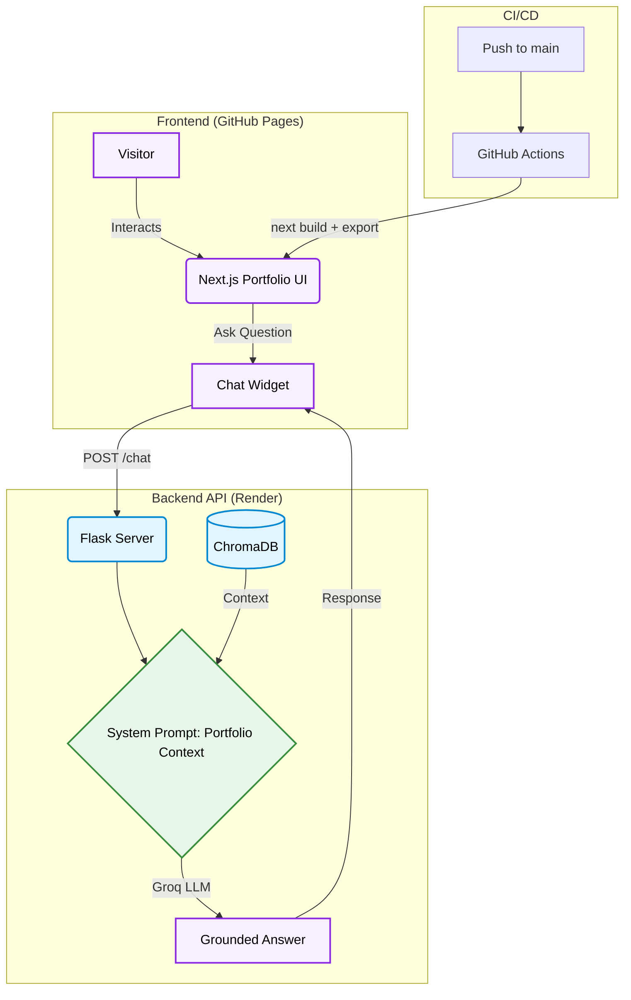

# Portfolio

A fast, responsive developer portfolio built with Next.js, featuring a RAG-powered AI chatbot that answers questions about my experience and projects.

> **Live Deployments:**
> * **Interactive Portfolio:** [shashank17singh.github.io](https://shashank17singh.github.io/)

---

## Overview

This repository contains the source code for my personal developer portfolio, detailing my engineering experience, technical skills, and featured open-source systems across machine learning, systems programming, and distributed systems.

The portfolio is architected as a Next.js single-page application statically exported to GitHub Pages. Continuous Integration and deployment are automated via GitHub Actions on every push to `main`. An integrated Retrieval-Augmented Generation (RAG) assistant, hosted on Render, allows visitors to chat with an AI agent grounded strictly in my verified resume and project artifacts.

---

## Architecture Overview



---

## Features

| Feature | Description |
| ------- | ----------- |
| **Responsive Design** | Fluid typography and layout scaling seamlessly across mobile, tablet, and widescreen viewports |
| **Featured Projects Grid** | Filterable project showcase displaying architecture badges, technical summaries, and live deployment links |
| **Interactive Animations** | Smooth scroll-reveal states, hardware-accelerated transitions, and micro-interactions |
| **Refined Dark Aesthetic** | Consistent slate and sapphire theme engineered for low eye fatigue |
| **Grounded AI Assistant** | RAG-backed chatbot providing verifiable answers about technical projects and work experience |
| **Automated Publishing** | Automated GitHub Actions workflow compiling static Next.js assets to GitHub Pages on push |

---

## Technology Stack

| Component | Technology |
| --------- | ---------- |
| Frontend Framework | Next.js 16 (Static Export), React 19, TypeScript |
| Web Hosting | GitHub Pages |
| CI/CD Pipeline | GitHub Actions |
| Backend API | Python 3.11+, Flask |
| LLM Inference | Groq API (`openai/gpt-oss-20b`) |
| Embeddings | Hugging Face (`sentence-transformers/all-MiniLM-L6-v2`) |
| Vector Store | ChromaDB |
| API Hosting | Render |
| Testing & Linting | pytest, ruff, ESLint |

---

## Project Structure

```
shashank17singh.github.io/
├── next_portfolio/         # Next.js frontend application
│   ├── app/                # Pages, layout, and UI components
│   ├── components/         # Chat widget, project cards, navigation
│   └── package.json        # Frontend dependencies
├── api/                    # Flask backend service
│   ├── app.py              # Flask server and /chat endpoint
│   ├── ingest.py           # Document chunker and ChromaDB ingestion pipeline
│   ├── Dockerfile          # Container configuration for Render
│   └── requirements.txt    # Python backend dependencies
├── tests/
│   ├── conftest.py
│   └── test_chat_logic.py  # Unit tests for RAG chat processing
├── .github/workflows/
│   └── deploy.yml          # Automated static export and GitHub Pages deployment
├── render.yaml             # Render infrastructure blueprint
└── README.md
```

---

## Setup and Installation

### Frontend

```bash
cd next_portfolio
npm install
npm run dev
```

The application starts locally at `http://localhost:3000`.

To generate the static production export:

```bash
npm run build
```

Configure the backend URL in `next_portfolio/.env.local`:

```bash
NEXT_PUBLIC_API_URL=http://localhost:5000
```

### Backend (Chatbot API)

```bash
cd api
pip install -r requirements.txt
echo "GROQ_API_KEY=your_api_key_here" > .env
python app.py
```

The Flask API listens locally at `http://localhost:5000`.

---

## Running the Tests

Execute automated Python backend tests:

```bash
pytest tests/
```

Run static code analysis:

```bash
ruff check .
```

---

## Deployment

- **Frontend:** Automatically built and published to GitHub Pages via `.github/workflows/deploy.yml` on pushes to `main`.
- **Backend:** Packaged via Docker and deployed on Render with scoped CORS origins.

Live production URL: [shashank17singh.github.io](https://shashank17singh.github.io/)

---

## Known Limitations

- Static GitHub Pages hosting requires client-side search execution; the interactive chat assistant communicates with a remote API that may spin down during prolonged cold inactivity on free-tier hosting.
- The assistant's answers are strictly bounded by indexed resume paragraphs to avoid hallucinations regarding unlisted proficiencies.

---

## Connect with Me

- **LinkedIn**: [Shashank Singh](https://www.linkedin.com/in/shashank17singh/)
- **GitHub**: [@Shashank17singh](https://github.com/Shashank17singh)
- **Email**: [shashanksingh1709@gmail.com](mailto:shashanksingh1709@gmail.com)

---

## License

This project is licensed under the MIT License. See [LICENSE](LICENSE) for details.
